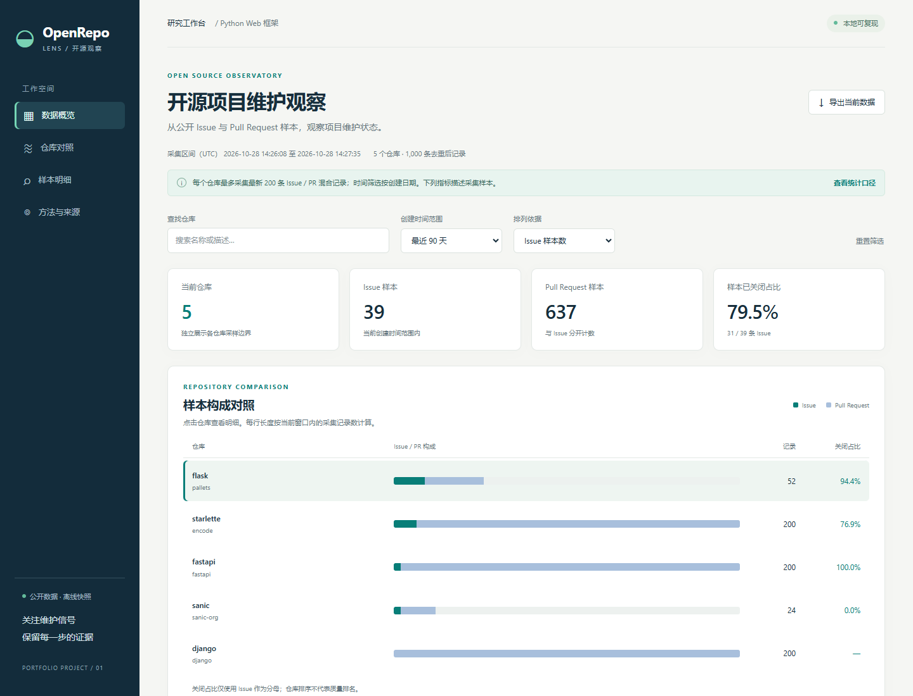

# OpenRepo Lens

用公开 GitHub 数据查看开源仓库的近期 Issue 与 PR 样本。工作台支持时间窗口筛选、仓库比较、记录详情和 JSON 导出，并同时展示样本覆盖范围。

[在线演示](https://hyperammonemia.github.io/openrepo-lens/) · [源代码](https://github.com/hyperammonemia/openrepo-lens)



## 查看演示

下载仓库后，用浏览器打开 `docs/index.html` 或 `output/index.html`。页面内嵌数据、样式和脚本，可以离线使用，无需安装 Python。页面中的原始 Issue 和仓库链接需要联网访问。

可以先切换 30 天和 90 天，搜索 `fastapi`，再打开 Django 的详情查看没有 Issue 样本时的显示方式。快照分析说明见 [output/report.html](output/report.html)，需要下载后在浏览器中打开。

## 为什么做这个工具

GitHub Issues 接口同时返回 Issue 和 Pull Request。如果直接用全部记录计算 Issue 关闭比例，结果会混入 PR。另一个问题是各仓库最新 200 条记录覆盖的时间长度不同，不能把这样的截取当成统一时间窗口的完整历史。

OpenRepo Lens 区分两类记录，按 ID 去重，并展示最早采集记录、截断情况和有效样本数。没有 Issue 时，关闭比例显示为缺失值。关闭耗时只描述已关闭且日期有效的 Issue；关闭原因可能是修复、重复或其他处理。

## 保存的快照

2026 年 10 月 28 日的快照来自 Flask、Django、FastAPI、Starlette 和 Sanic：5 个仓库，1,000 条记录，其中 134 条 Issue、866 条 PR。每个仓库读取基本信息、两页记录和一页 release 列表，共 20 次成功请求。

[data/manifest.json](data/manifest.json) 保存请求地址、读取时间、原始文件位置和 SHA256 校验值。响应正文保存在 `data/raw/`，计算结果保存在 [output/analysis.json](output/analysis.json)。离线分析会校验原始文件；文件缺失或内容不一致时，会将异常写入覆盖信息。

这是方便采集的框架样本，不能代表所有开源项目。各响应顺序读取，状态对应各自读取时刻。工具提供描述性比较，未定义维护质量排名或风险总分。Release 列表的第一条记录可能是预发布，空列表也不代表软件从未发布版本。

## 离线复现

使用 Python 3.10 或更高版本。数据管线、页面构建和 Python 测试只依赖标准库。

```sh
python pipeline.py analyze
python build.py
python make_report.py
python -m unittest discover -s tests -v
```

`docs/index.html` 是随仓库保存的静态演示副本。更新输出后，可同步演示文件：

```sh
python -c "from pathlib import Path; Path('docs/index.html').write_bytes(Path('output/index.html').read_bytes())"
```

重新采集公开数据：

```sh
python pipeline.py collect
python build.py
python make_report.py
```

采集不读取凭证。每次采集保存新的原始响应目录，并更新当前清单。匿名请求受到 GitHub 限额约束；失败与缺失会保留在输出中。复现旧快照时，需要使用对应清单和响应目录。

## 验证

随仓库保存的快照通过 14 项 Python 测试和 9 项本地 Chrome 浏览器检查。Python 测试覆盖 PR 排除、时间边界、去重、无效日期、空样本、原始文件校验及离线重算。结果见 [output/validation.json](output/validation.json)。

GitHub Actions 配置在 Python 3.10 和 3.14 上重建离线输出并运行测试；工作流实际运行状态以仓库 Actions 页面为准。浏览器检查为可选开发步骤：

```sh
npm install --ignore-scripts
npm run test:ui
```

浏览器检查默认使用 Windows 本机 Chrome。其他环境可用 `BROWSER_PATH` 指定 Chrome 或 Chromium 的可执行文件。Playwright 不影响离线演示或 Python 复现。

## 文件结构

| 文件或目录 | 内容 |
| --- | --- |
| `pipeline.py` | 公开数据采集、去重与指标计算 |
| `build.py` | 生成独立 HTML 工作台 |
| `make_report.py` | 生成快照分析说明 |
| `web/` | 页面模板、样式和交互 |
| `tests/` | 指标、数据一致性和浏览器检查 |
| `data/` | 原始响应和来源清单 |
| `output/` | 计算结果、演示、报告与验证记录 |
| `docs/index.html` | 可用于静态托管的演示副本 |

## 项目分工与许可

这是 AI 协作个人项目。用户提出并委托项目，AI 执行选题细化、代码实现、数据采集、分析和文档整理。保存的测试记录来自该实现过程，没有企业试用或真实用户效果数据。

接口依据为 [GitHub Issues 文档](https://docs.github.com/en/rest/issues/issues)、[分页说明](https://docs.github.com/en/rest/using-the-rest-api/using-pagination-in-the-rest-api)和[限流说明](https://docs.github.com/en/rest/using-the-rest-api/rate-limits-for-the-rest-api)。

代码按 [MIT 许可证](LICENSE)提供。原始 GitHub 内容和项目名称属于各自权利人，不因本项目代码许可证而重新授权。
